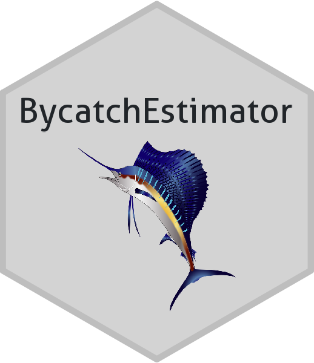

# BycatchAppICCAT 

A point-and-click interface to the [BycatchEstimator](https://github.com/ebabcock/BycatchEstimator) R package. The app lets practitioners estimate bycatch from observer and logbook data without writing any code.

## What the app does

- **Bycatch setup:** upload observer and logbook data and align fishing effort between them.
- **Data checks:** review summaries and plots to confirm the data are suitable.
- **Design-based estimators:** estimate bycatch with the Ratio and Delta methods, with measures of uncertainty.
- **Download outputs:** save reports, tables and data files as a zip folder.

## Access the Bycatch App on the web

- [Bycatch App on the web](https://iccat.shinyapps.io/BYET/)
- [Source code on GitHub](https://github.com/ICCAT/BycatchAppICCAT)
The web application appears to function correctly in Chrome, Edge, and FireFox. However, we do not recommend the DuckDuckGo browser as its privacy setting may prevent some features from working correctly.

## Desktop Installation

You can install and run this web app on your local machine, if you prefer.

You need [R](https://cran.r-project.org) and [RStudio Desktop](https://posit.co/download/rstudio-desktop/).

```r
install.packages("remotes") #Once
remotes::install_github("ICCAT/BycatchAppICCAT") #Once
```

The installation also installs the packages the app depends on, so the first install can take several minutes.

## Starting the app

```r
BycatchAppICCAT::run_bycatch_app() #Every time
```

The app opens in your default web browser. To stop it, close the browser tab and click the **Stop** button in the RStudio Console.

## Requirements

- R, version >= 4.6.1
- A web browser
- [Pandoc](https://pandoc.org/installing.html), which is needed to create the reports. RStudio includes it. Install it separately only if you use R without RStudio.

## User guide

- [User Guide link](https://iccat.github.io/BycatchAppICCAT/)

## Related

- [BycatchEstimator R package](https://ebabcock.github.io/BycatchEstimator/)
