```{r setup, include=FALSE}
knitr::opts_chunk$set(
  collapse = TRUE,
  comment = "#>",
  echo = TRUE,
  eval = FALSE
)
```

> **Web application version 1.1** 

## 1. Introduction

### 1.1 About this guide

This guide explains how to use the **BycatchEstimator** web application to estimate bycatch from observer and logbook data without writing any code. It is written for practitioners and assumes no experience with R. This web application is developed and maintained by the International Commission for the Conservation of Atlantic Tuna (ICCAT).

This web application is intended to make the R package known as BycatchEstimator toolkit (BYET) accessible to a wide audience of practitioners with little or no experience with writing code to conduct statistical analysis. Its development is motivated by fostering accessibility and capacity for bycatch estimation among ICCAT Contracting Parties and Cooperating non-Contracting Parties, Entities or Fishing Entities (CPCs).

As noted, this web application is an alternative pathway to accessing the BYET. The BYET is a statistical framework for bycatch estimation that has been developed as a freely available R package under the title `BycatchEstimator` (Babcock et al. 2025). Within the BYET, types of available analyses are categorized into model-based bycatch estimation and design-based bycatch estimation. Within this web application, users have access to design-based estimators. Design-based estimators include a stratified ratio estimator and the delta-lognormal estimator of Pennington (1983). Advanced users who are interested in model-based bycatch estimation are encouraged to access these approaches by using the R package known as `BycatchEstimator`.

Throughout the guide, the names of buttons, menu items and fields appear in **bold**. Boxes marked **Tip**, **Note**, and **Important** highlight useful advice and common pitfalls.

### 1.2 What the app does

The app is an alternative interface to the `BycatchEstimator` R package. It produces estimates of bycatch by expanding a sample, such as an observer database, to the total fishing effort recorded in logbooks or landings records. The app is organized into four modules that you work through in order:

1. **Bycatch setup**: upload observer and logbook data, tell the app how to interpret your data columns, and align fishing effort between the two types of datasets.
2. **Data checks**: review statistical summaries and plots to make sure the data are appropriate for bycatch estimation.
3. **Design-based estimators**: produce estimates of bycatch (Ratio and Delta methods) with measures of uncertainty.
4. **Download outputs**: save reports, tables and data files in a single zip folder.

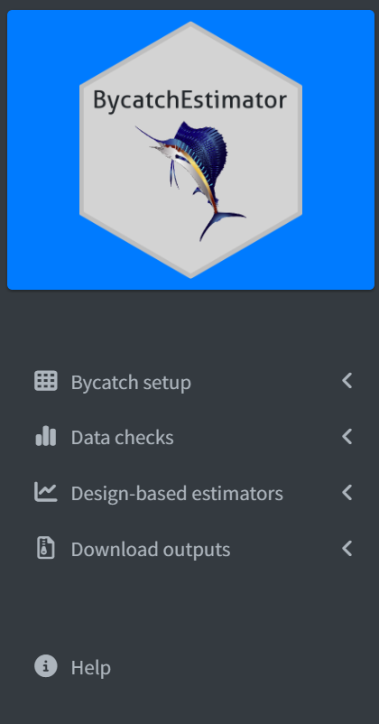
<div style="margin-bottom: 1.5rem;"></div>

### 1.3 Before you begin

You will need:

* A computer with a recent version of R installed. RStudio is required (Section 1.4).
* The `BycatchEstimatorApp` package, which contains the app (Section 1.4).
* An observer dataset saved as a CSV file.
* A logbook dataset saved as a CSV file.
* The common and scientific names of the species you are analysing.
* A current web browser. The app opens in your default browser.
* An internet connection is required during installation.

Section 2 explains how the data files should be structured.

### 1.4 Installing and starting the app

The app is distributed as an R package. You install it once and then start it with a single line of code. You do not need to write any R code beyond the lines shown here.

#### Step A: Install R and RStudio (first time only)

1. Download and install R from <https://cran.r-project.org>. Accept the default options.
2. Download and install RStudio Desktop from <https://posit.co/download/rstudio-desktop/>. RStudio is a free program that makes R easier to use, and it includes everything the app needs to create reports. You may be tempted to run the app in R without using RStudio; however, RStudio contains Pandoc, which is necessary for downloading reports.

> **Note:** If you use R without RStudio, you must also install Pandoc (<https://pandoc.org/installing.html>). Without it, the app cannot create the Data checks and Analysis results reports.

#### Step B: Install the app package (first time only)

1. Open RStudio.
2. Find the **Console**, the window with a `>` prompt, usually at the bottom left.
3. Type or paste the installation command below, then press **Enter**.
4. Wait for the installation to finish. The first installation can take several minutes because the app needs a number of supporting packages. If R asks whether to install or update packages, accept the defaults.

```r
install.packages("remotes") #Once
remotes::install_github("ICCAT/BycatchAppICCAT") #Once
```

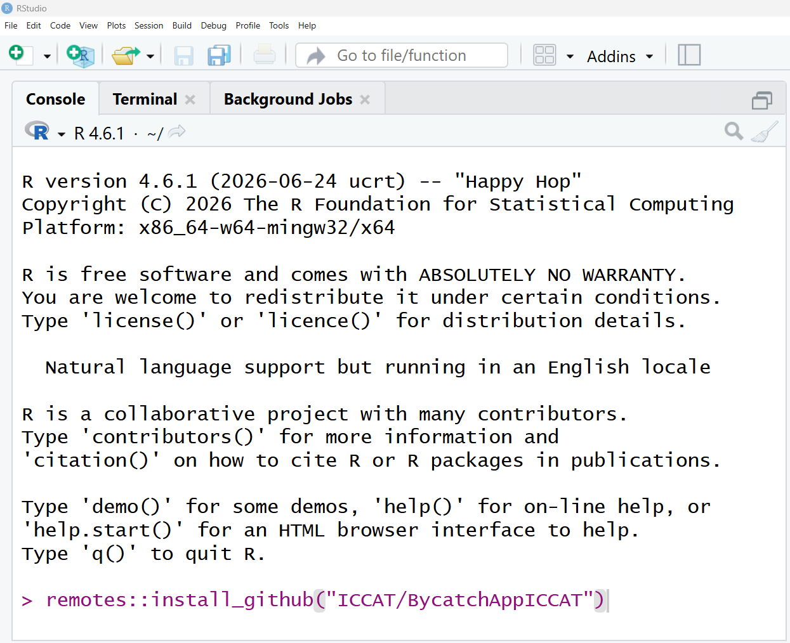
<div style="margin-bottom: 1.5rem;"></div>

#### Step C: Start the app

Type or paste the following line in the Console and press **Enter**:

```r
BycatchEstimatorApp::run_bycatch_app()
```

The app opens in your default web browser. Starting the app can take a few seconds, please be patient.

If the browser does not open by itself, look in the Console for a line that says `Listening on` followed by an address such as `http://127.0.0.1:1234`. Copy that address into your browser.

While the app is running, the Console stays busy and you cannot type new commands there. This is normal.

> **Important:** To stop the app, close the browser tab and click the red **Stop** button in the RStudio Console. Stopping the app ends your session and deletes the session’s temporary results, so download what you need first (Section 6).

#### Starting the app next time and updating it

After the first installation, you only need Step C: open RStudio and run the same line. You do not need to repeat Steps A and B. When you run this app on your local machine, files you attach are read by the copy of the app running on your own computer.

### 1.5 Finding your way around

* **Sidebar menu (Fig. 3).** Each module has an **Instructions** page followed by numbered steps. Use the icon at the top of the page to open or close the sidebar. **Help** is at the bottom.
* **Progress badges.** Each numbered step has a badge. A blue number means the step is not complete; a green check mark means it is complete.
* **Information icons.** The small circle-info icons beside a heading open a short tip about that step.
* **Red asterisks.** Fields marked with a red asterisk (`*`) are mandatory.
* **Grey “not available” banners.** Later modules stay locked until **Bycatch setup** is activated. The banner tells you what is missing.
* **Screen lock.** When you attach a file, click **Activate**, run an analysis, deactivate, reset or start a download, the app briefly locks the entire browser screen while it works. Wait for it to clear before clicking again.

> **Important:** Your files and results are held in a temporary workspace that belongs to your current session. The workspace is deleted when the session ends, for example when you close the browser tab or stop the app in RStudio. Reloading the page starts a new, empty session. Download your results (Section 6) before you leave.

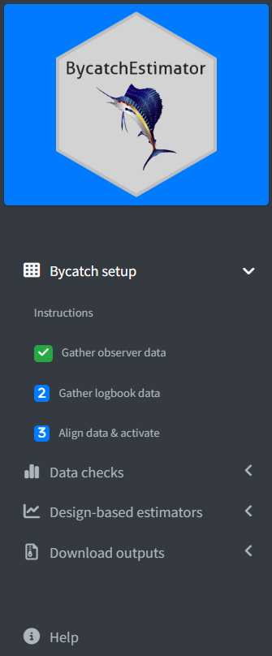
<div style="margin-bottom: 1.5rem;"></div>

### 1.6 Quick start

1. **First time only:** install R, RStudio and the app package (Section 1.4). Then start the app with `BycatchEstimatorApp::run_bycatch_app()`.
2. **Optional:** open **Bycatch setup > Instructions** and download the practice datasets.
3. **Gather observer data:** attach your CSV, choose the year and catch columns, units, catch type, and a title, then advance.
4. **Gather logbook data:** attach your CSV, choose the year column and a title, then advance.
5. **Align data & activate:** align the effort columns, add any factor variables, enter species names and a description, then click **Activate**.
6. **Data checks > Diagnostics & summary:** read the report and fix any data problems.
7. **Design-based estimators > Specifications:** choose stratification variables, methods and a scenario name, then click **Run analysis**.
8. **Analysis results:** review the estimates.
9. **Download outputs:** download the zip folder before you close the browser.

---

## 2. Preparing your data

The app uses two datasets, one from the observer program and one describing total fishing effort. Getting these right before you start will save time.

### 2.1 File requirements

| Requirement | Details |
| :--- | :--- |
| **File format** | CSV only (`.csv`). |
| **File size** | Files larger than 100 MB will not upload. |
| **Column names** | The first row of each file must contain column names. |
| **Number of files** | One observer file and one logbook file. |

### 2.2 What each dataset should contain

| Component | Observer dataset | Logbook dataset |
| :--- | :--- | :--- |
| **Each row** | One sample unit: a trip or a set. | One record of fishing effort. It may be one trip or set per row, or it may be aggregated (for example, by year and area). |
| **Year** | A column giving the year. | A column giving the year. |
| **Catch** | A column with the amount of the bycatch species caught. | Not needed. |
| **Effort** | A column measuring fishing effort. | A column measuring fishing effort, in the same units as the observer data. |
| **Factor variables (optional)** | Categorical columns such as area, gear or season. | The same variables, ideally with identical column names and category labels. |
| **Counts of sample units (only if aggregated)** | Not needed. | A column giving the number of trips or sets represented by each row. |

### 2.3 Protected column names

The app uses four column names internally: `Year`, `Catch`, `Effort` and `SampleUnits`. If your file already has a column with one of these names, you must select that column for that role. Otherwise, the app shows a red warning. To fix it, either select the column with the reserved name, or rename or remove it in your file and upload the file again. The warning appears in red directly below the field as soon as you make the selection, and the step cannot be completed until it is resolved.

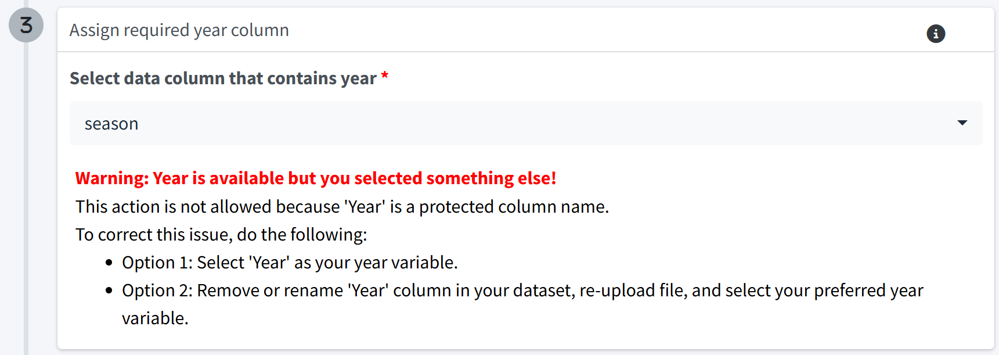
<div style="margin-bottom: 1.5rem;"></div>

| Reserved name | Role | Applies to |
| :--- | :--- | :--- |
| `Year` | Year column | Observer and logbook data |
| `Catch` | Catch column | Observer data |
| `Effort` | Effort column | Observer and logbook data |
| `SampleUnits` | Counts of sample units | Logbook data (only if aggregated further) |

### 2.4 Practice datasets

Three pairs of example files are available under **Bycatch setup > Instructions**. Expand a box to preview the first rows, then click **Download observer data** or **Download logbook data**.

#### Simple observer and logbook datasets
Downloaded as `observerdata_simple.csv` and `logbookdata_simple.csv`.

* **Observer data:**
  * `Year`: year variable
  * `Catch`: catch variable
  * `sampled.sets`: Effort variable, total effort for the fishing trip
  * Each row is a fishing trip
  * `EW` and `season` are optional design stratification and/or grouping variables.
* **Logbook data:**
  * `Year`: year variable
  * `sets`: Effort variable, total effort for the fishing trip
  * Each row is a fishing trip
  * `EW` and `season` are optional design stratification and/or grouping variables.

#### Simple observer with aggregated logbook datasets
Downloaded as `observerdata_simple.csv` and `logbookdata_aggregate.csv`.

* **Observer data:**
  * `Year`: year variable
  * `Catch`: catch variable
  * `sampled.sets`: Effort variable, total effort for the trip
  * Each row is a fishing trip
  * `EW` and `season` are optional design stratification and/or grouping variables.
* **Logbook data:**
  * `Year`: year variable
  * `sets`: Effort variable, sum of effort across several trips
  * `trips`: number of trips in the record (row).
  * Each row is an aggregation of multiple fishing trips, as indicated by the `trips` column.
  * `EW` and `season` are optional design stratification and/or grouping variables.

#### Complex observer and logbook datasets from LLSIM
Downloaded as `observerdata_LLSIM.csv` and `logbookdata_LLSIM.csv`.

Please see the following reference documents for usage details:

* Babcock, E.A., W.J. Harford, T. Gedamke, D. Soto, and C. P. Goodyear. 2022. Efficacy of a bycatch estimation tool. *Collect. Vol. Sci. Pap. ICCAT*, 79(5): 304-339.
* Babcock, E.A. and C. P. Goodyear. 2021. Testing a bycatch estimation tool using simulated blue marlin longline data. *ICCAT Collect. Vol. Sci. Pap. ICCAT*, 78(5): 179-189.

---

## 3. Module 1: Bycatch setup

**Bycatch setup** must be completed before any other module can be used. It has three parts, each with its own badge in the sidebar:

1. **Gather observer data**
2. **Gather logbook data**
3. **Align data & activate**

> **Tip:** Complete Parts 1 and 2 fully before starting Part 3. Changing anything in Part 1 or Part 2 clears the entries you have made in Part 3.

### 3.1 Part 1: Gather observer data

1. Open **Bycatch setup > Gather observer data**.
2. Click **Attach** and choose your observer CSV file. The app reads the file and fills in a suggested title from the file name.
3. Check the preview table (“Review your observer dataset”) to confirm the data loaded as expected.
4. Select the column that contains year.
5. Select the column that contains catch, then choose the units of catch and the catch type.
6. Check the title and edit it if you wish (maximum 50 characters) and click **Advance to part 2: Gather logbook data**.

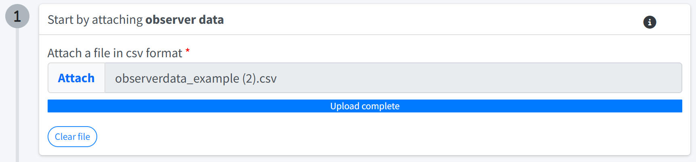
<div style="margin-bottom: 1.5rem;"></div>

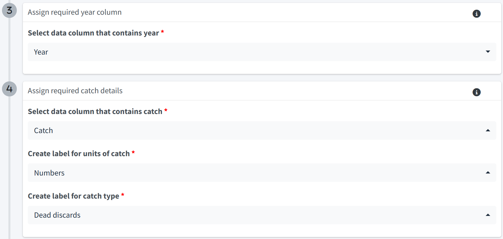
<div style="margin-bottom: 1.5rem;"></div>

| Field | Required | What to enter |
| :--- | :--- | :--- |
| **Attach a file** | Yes | Your observer data as a CSV file (up to 100 MB). |
| **Select column that contains year** | Yes | The column holding the year of each record. |
| **Select column that contains catch** | Yes | The column holding the amount of the bycatch species. It must be a different column from year. |
| **Units of catch** | Yes | Numbers, Weight in kg, Weight in tonnes, or Other. |
| **Catch type** | Yes | Dead discards, Live discards, Discards, Bycatch, or Other. |
| **Title** | Yes | A short name for the dataset (maximum 50 characters). |

> **Note:** If a message says “Invalid file type” or “Error reading file”, the file could not be loaded. Save it as a CSV and try again. Use **Clear file** to remove the attached file and start over.

When every mandatory field is complete, the **Part 1** badge turns into a green check mark.

### 3.2 Part 2: Gather logbook data

1. Open **Bycatch setup > Gather logbook data**.
2. Click **Attach** and choose your logbook CSV file.
3. Check the preview table (“Review your logbook dataset”).
4. Select the column that contains year.
5. Check or edit the title (maximum 50 characters) and click **Advance to part 3: Align data and activate**.

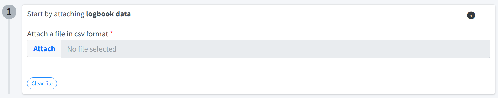

<div style="margin-bottom: 1.5rem;"></div>

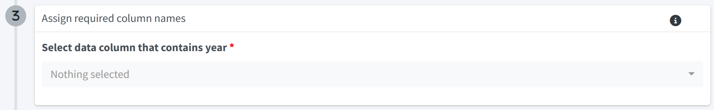
<div style="margin-bottom: 1.5rem;"></div>

The same reserved-name rule applies here: if your logbook file has a column called `Year`, you must select it as the year column (see Section 2.3). The **Part 2** badge turns green when the form is complete.

### 3.3 Part 3: Align data & activate

In this part you tell the app how fishing effort in the observer data lines up with fishing effort in the logbook data, so that the observer sample can be scaled up to total effort. The page stays locked, with a grey “Align data & activate is not available” banner, until Parts 1 and 2 are complete.

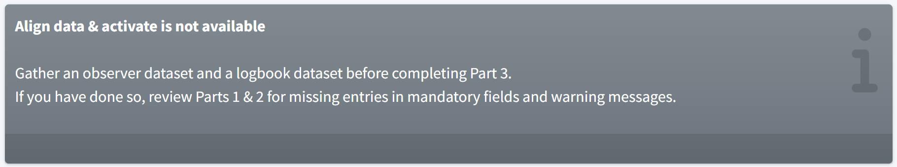
<div style="margin-bottom: 1.5rem;"></div>

#### Step 1: Specify and align fishing effort

Two panels appear side by side, one for the observer data and one for the logbook data.

| Panel | Field | What to enter |
| :--- | :--- | :--- |
| **Observer effort** | **Select column that contains effort** | The observer column that measures fishing effort. |
| **Observer effort** | **Specify sample unit of observer effort** | **Trip** or **Set**: what each row of the observer data represents. |
| **Logbook effort** | **Select column that contains effort** | The logbook column that measures fishing effort. |
| **Logbook effort** | **Specify aggregation level of logbook effort** | **Same aggregation as observer data** if each logbook row is also one trip or set; otherwise **Aggregated further**. |
| **Logbook effort** | **Specify column containing counts of sample units** | Appears only if you chose **Aggregated further**. Select the logbook column that gives the number of trips or sets in each row. |

For example, if the observer sample unit is a trip but the logbook data are summarised by year and area, the logbook data need a column giving the number of trips for each year and area. Select that column as the counts of sample units.

> **Tip:** Setting up fishing effort is the trickiest part of the setup. Expand the **Help! Setting up fishing effort is tricky** box on this page to see four worked examples. The box is also summarized below in table form.

| Example | Observer sample unit | Logbook aggregation | Counts column needed? |
| :--- | :--- | :--- | :--- |
| **A** | Trip | Same aggregation as observer data | No |
| **B** | Set | Same aggregation as observer data | No |
| **C** | Trip | Aggregated further | Yes (number of trips per row) |
| **D** | Set | Aggregated further | Yes (number of sets per row) |

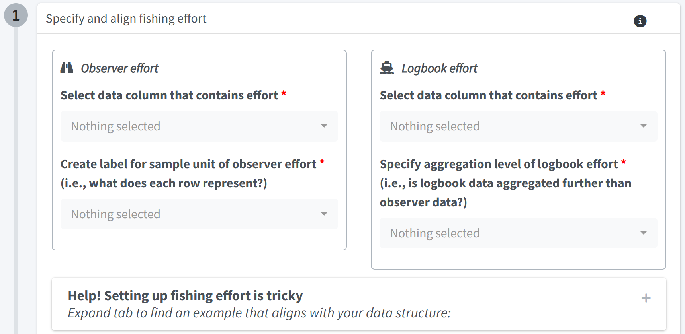
<div style="margin-bottom: 1.5rem;"></div>

> **Note:** The effort column cannot be the same column as year or catch (observer data) or year (logbook data), and it cannot be used as a factor variable. The counts-of-sample-units column must also be different from the logbook effort column. A red warning appears if the two match.

#### Step 2: Select factor variables (optional)

Factor variables are categorical columns, such as area, gear type or season, that the app can use to define strata and groups later in the analysis. `Year` is added for you automatically.

1. Click **Add variable**.
2. Under **Observer dataset**, select the factor column.
3. Under **Logbook dataset**, select the corresponding column.
4. Repeat for each additional factor. Click **Remove** to delete a row you do not want.

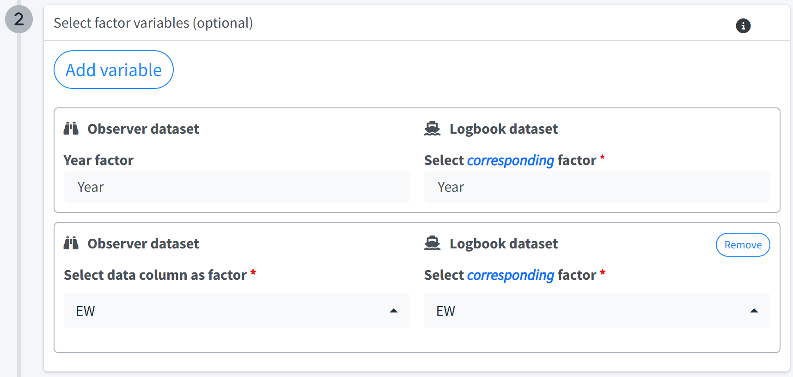
<div style="margin-bottom: 1.5rem;"></div>

> **Note:** 
> * The observer and logbook column names should almost always be identical.
> * If they differ, the app renames the logbook column to match the observer name. Renaming can occasionally cause processing errors, so use it with care.
> * Each observer column and each logbook column can be selected only once.
> * Matching factor names are required for the analysis.
> * Do not select an effort column as a factor. A red warning appears (“observer effort cannot be selected as a factor variable!” or the logbook equivalent), and activation will fail.

> **Tip:** Select all factor variables of interest. All selected variables will be included in **Data checks**, which is useful for reviewing statistical summaries before proceeding to analysis. During the setup of **Design-based estimators**, you will be prompted to choose one or more factor variables from the list created here.

#### Step 3: Specify metadata

All three fields are mandatory:

* Add a species common name (maximum 20 characters).
* Add a species scientific name (maximum 20 characters).
* Add a brief description of the run (maximum 50 characters).

#### Step 4: Activate

1. Click **Activate**. A message confirms whether activation worked.
2. If it succeeds, you see **Activation completed** and the page switches to the **Activation summary**.
3. Review the summary table. It shows the titles, columns and settings you chose, and marks any renamed variable as `old name → new name`. Two small tables show the first rows of each dataset with their effort columns and sample unit.
4. Check that the summary matches your understanding of your data. If it does not, deactivate and correct your entries.

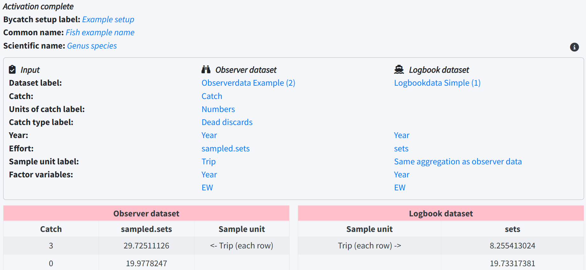
<div style="margin-bottom: 1.5rem;"></div>

> **Note:** If activation fails, a message titled **Activation failed** appears. Check the following:
> * All mandatory fields are filled in.
> * No red warning messages are showing.
> * Each observer factor variable is selected only once.
> * Each logbook factor variable is selected only once.
> * The effort column is not selected as a factor variable.
> 
> If you see **Run checks failed** instead, review your selections for errors, in particular the effort, sample unit and any renamed factors. A red notification also shows technical details, which are helpful if you need to ask for support.

> **Note:** Once setup is active, Parts 1 and 2 are locked and show a green “complete” banner, and the badges for Part 3, **Data checks** and **Download** turn green.

#### Changing your setup: Deactivate

To change your observer or logbook data or any setup choice, click **Deactivate and return to previous** on the **Activation summary** tab and confirm.

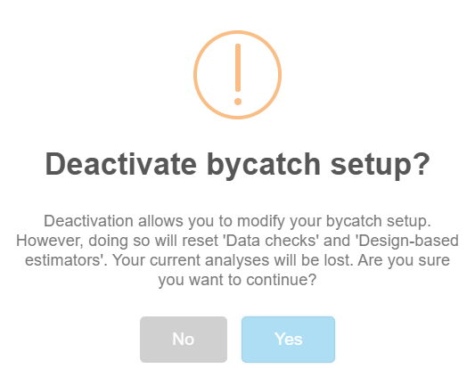
<div style="margin-bottom: 1.5rem;"></div>

> **Important:** Deactivating resets **Data checks** and **Design-based estimators**, and your current analyses are lost. Download anything you want to keep first (Section 6).

---

## 4. Module 2: Data checks

Complete **Bycatch setup** before using this module. **Data checks** provides:

* **Review of data:** summaries of data quantity and quality, such as observer coverage levels.
* **Plots and tables:** always plot your data before moving on to analysis.
* **Warnings:** missing or likely problematic data points are flagged.

### 4.1 Diagnostics & summary

Open **Data checks > Diagnostics & summary**. If you see a grey “not available” banner, return to **Bycatch setup** and activate. Wait for the report to load (a spinner is shown). Scroll down through the report. It is long and displays inside the app.

The report includes warning messages about missing data or `NA`s; figures and tables showing sample sizes and the presence or absence of the bycatch species across levels of exploratory variables; observer coverage levels; raw trends in catch per unit effort (CPUE); and a summary of the available data.

> **Tip:** The Data checks report is also included in the zip file you can download (Section 6).

---

## 5. Module 3: Design-based estimators

Complete **Bycatch setup** before using this module. **Design-based estimators** provide:

* **Estimates of bycatch:** total annual bycatch produced by expanding the observer sample to total logbook effort.
* **Multiple methods:** the Ratio and Delta methods.
* **Uncertainty:** yearly estimates with standard errors, and a figure showing the estimates with 95% confidence intervals.

### 5.1 Specifications

Open **Design-based estimators > Specifications**.

> **Tip:** If a variable you want is missing from the stratification or grouping lists, it was not added as a factor in **Bycatch setup**. Deactivate the setup and add it (see Section 3.3, Step 2).

#### Step 1: Select one or more design stratification variables (mandatory)
Total bycatch is estimated separately at each level of the variables you select. Choices come from the factor variables you set up in **Bycatch setup** (including `Year`).

This is also the step where pooling is specified, if necessary. To deal with strata that have no observations or few observations, the user may request pooling for any selected stratification variable. If pooling, the total bycatch is estimated for the observer and logbook data specified by the pooling scheme for each stratum (i.e. combination of variables) and then allocated to the stratum according to the fraction of the logbook effort in the pooled data that is in the stratum of interest. Unpooled estimates are used for strata with sufficient data. Variances are also allocated to the stratum of interest based on the fraction of total effort. Select `none` for each stratification variable to avoid pooling.

If pooling is requested, the strata will be pooled in the order the selected variables are displayed in this step. You must also specify **Minimum stratification unit**, which is the minimum number of sample units needed to avoid pooling and must be a value greater than 0. Pooling type must also be selected:

* Pooling type `pooledVar` applies an alternate variable to the selected stratification variable (e.g., `season` rather than `month`). If `pooledVar` is used, the name of the alternate variable must be specified.
* Pooling can also be carried out across `all` values.
* Pooling type `adjacent` is only available for the `Year` variable. If `adjacent` is used, ensure that **Number of adjacent years** is greater than 0, which specifies the number of adjacent years to include for the adjacent year method (e.g., `1` to include both the previous and following year).

#### Step 2: Optionally, select grouping variables
Factor variables are used to summarise the estimates, for example total bycatch by statistical area in each year, or a summary by a variable other than `Year`. A grouping variable does not have to be a stratification variable. If it is not, the estimates are allocated across its levels in proportion to total logbook effort.

#### Step 3: Select one or both analysis methods

Both methods are used to estimate total bycatch from a fishery by expanding data obtained from an observer program.

**Ratio method:** This method assumes a linear relationship between total bycatch and total fishing effort. Similar estimates can be obtained when fishing effort is replaced by target species catch or landed weight. In a simple randomized sampling design, total bycatch is calculated by multiplying the bycatch rate (e.g., catch-per-unit-effort from the observer program) by the total fleet wide effort obtained from logbooks. This approach can similarly be applied to stratified random sampling designs. When data are divided into strata, bycatch is estimated for each stratum, with total bycatch calculated as summation across strata (Rao 2000). 

**Delta method:** This method is useful when the observer data contain a high proportion of zeros and heavily skewed positive catches. The approach of Pennington (1983) divides the observer data into two components: *Encounter probability*, which is the proportion of fishing events where at least 1 individual is caught, and *Positive catch rate*, which is the mean catch rates among only the non-zero fishing events. The Positive catch rate is assumed to follow a log-normal distribution. The overall catch rate is calculated as the product of these two components. The total bycatch is the product of the overall catch rate and fleet wide effort obtained from logbooks. When data are divided into strata, bycatch is estimated for each stratum, with total bycatch calculated as summation across strata.

#### Step 4: Enter a scenario name
Enter a name for this analysis (maximum 100 characters).

#### Step 5: Click Run analysis
When the analysis succeeds, **Analysis completed** appears and the page switches to the **Analysis summary** tab, which recaps your inputs. If it fails, a message tells you to review your fields for missing entries or warnings; a red notification gives technical details.

### 5.2 Analysis results

1. Open **Design-based estimators > Analysis results**.
2. Scroll through the report that displays in the app.

The report contains the bycatch estimates, tables of annual totals for each method with standard errors (and the same by group, if you chose a grouping variable), and a figure of estimates by year with 95% confidence intervals.

> **Tip:** The Data analysis report is also included in the zip file you can download (Section 6).

### 5.3 Trying a different analysis

To change your specifications, click **Reset analysis and return to previous** on the **Analysis summary** tab and confirm. This deletes the current design-based analysis, so download your results first.

---

## 6. Module 4: Download outputs

At minimum, **Bycatch setup** must be complete before you can download. Anything that has been run is included.

1. Open **Download outputs > Download**.
2. Click **Download results as ZIP**. Your browser saves a file called `bycatch_results.zip`.
3. Open the circle-info icon beside the button to see a summary of what the zip contains.

| Stage | Contents of the zip |
| :--- | :--- |
| **Bycatch setup** | • The observer and logbook datasets (`observer_dataset` and `logbook_dataset`).<br>• A summary of the inputs you chose in the app (`bycatch_inputs`).<br>• `DataSummary` and `StrataSummary` files with data summaries by year and factor variables.<br>• An `.rds` file that can be read in R. |
| **Data checks** | • The Data checks report (HTML), with warnings, summary figures and tables, observer coverage and raw CPUE trends. |
| **Design-based estimators** | • The analysis report with bycatch estimates (HTML), included only if an analysis has been run.<br>• Tables of total estimates by year for each method, with standard errors, and the same by group if requested.<br>• An `.rds` file that can be read in R. |

> **Tip:** If you have completed **Bycatch setup** but not conducted an analysis using **Design-based estimators**, you can still download a ZIP file. The file will contain outputs from **Bycatch setup** and **Data Checks**, as listed in the table above.

> **Important:** Download your results before you deactivate the setup, reset an analysis, reload the page or close the browser. These actions delete your results.

---

## 7. Help and further resources

The **Help** page (bottom of the sidebar) links to online resources:

* **BycatchEstimator R package on GitHub:** <https://github.com/ebabcock/BycatchEstimator>
* **BycatchEstimator R package User Guide:** <https://ebabcock.github.io/BycatchEstimator/>

---

## 8. Troubleshooting

| Problem | Likely cause | What to do |
| :--- | :--- | :--- |
| `Error: there is no package called ‘BycatchEstimatorApp’` | The package is not installed, or installation did not finish. | Repeat the installation (Section 1.4, Step B), then restart RStudio and try again. |
| `Error: could not find function “run_bycatch_app”` | The command was mistyped or the package name was left out. | Type the command exactly as shown, including `BycatchEstimatorApp::`. |
| The app does not open in the browser | The browser did not launch automatically. | Copy the address after `Listening on` in the RStudio Console into your browser. |
| Reports do not appear, or an error mentions Pandoc | Pandoc is missing, which can happen when R is used without RStudio. | Run the app from RStudio, or install Pandoc (<https://pandoc.org/installing.html>). |
| “Invalid file type” message | The file is not a `.csv`. | Save the file as CSV and attach it again. |
| “Error reading file” message | The file could not be read as a CSV. | Open the file in a spreadsheet, check it, and re-save it as CSV. |
| A large file will not upload | Files over 100 MB are not accepted. | Remove unused columns or rows and try again. |
| Red warning: “Year (or Catch, Effort, SampleUnits) is available but you selected something else!” | Your file has a column with a reserved name (Section 2.3). | Select that column for that role, or rename or remove it and re-upload. In Part 3, a reserved `Effort` or `SampleUnits` column is handled the same way. |
| Warning that counts of sample units and effort columns are identical | The same logbook column was chosen as the effort column and as the counts column. | Choose a different counts column. |
| Screen seems frozen or clicks do nothing | The app locks the screen briefly while a file loads, or while an activation, analysis or download runs. | Wait a few seconds for it to clear. Large files and analyses take longer. |
| Warning that the catch and year columns are identical | The same column was chosen for both. | Choose different columns. |
| Part 3 (or a later module) shows a grey “not available” banner | An earlier step is incomplete. | Look for blue number badges in the sidebar. Check mandatory fields (red asterisks) and warnings in Parts 1 and 2. |
| A column is missing from a dropdown | Year, catch and effort columns are left out of effort and factor lists. Stratification and grouping lists contain only the factor variables set up earlier. | Add the variable as a factor in Part 3 (deactivate first if needed). |
| “Activation failed” | A mandatory field is empty, a variable is duplicated, or effort is chosen as a factor. | Follow the checklist in the message (Section 3.3, Step 4). |
| “Run checks failed” | The setup could not be processed with your selections. | Review the effort, sample unit and factor choices. Renamed factors can cause errors, so try matching the column names in your files. |
| “Analysis failed” | A mandatory field is empty or the analysis could not be run. | Check the stratification variable(s) and scenario name, and review any warnings. |
| Parts 1 and 2 are locked | **Bycatch setup** is active. | Deactivate to edit them. Data checks and analyses will be reset. |
| Results have disappeared | The session ended, the page was reloaded, or you deactivated or reset. | Redo the steps. Download results early next time. |

---

## 9. Glossary

| Term | Meaning |
| :--- | :--- |
| **Observer data** | Records from trained observers on board vessels. It is the sample from which bycatch is estimated. |
| **Logbook data** | Fishing effort recorded for the whole fleet (or landings records), used to scale the observer sample up to the total. |
| **Effort** | A measure of fishing activity, such as hooks, hauls or trips. |
| **Sample unit** | What one observer row represents: a trip or a set. |
| **Aggregated further** | Logbook rows that each summarise many trips or sets (for example, by year and area). |
| **Factor variable** | A categorical column, such as area, gear or season. |
| **Stratification variable** | A factor used to split the data so that bycatch is estimated separately at each level. |
| **Grouping variable** | A factor used to summarise the estimates, without necessarily being a stratification variable. |
| **CPUE** | Catch per unit effort. |
| **Design-based estimator** | A method that expands a sample to the total effort. The app offers the Ratio and Delta methods. |
| **Scenario** | One named set of design-based specifications. |
| **R** | The free statistical programming language that the `BycatchEstimator` package is written in. |
| **RStudio** | A free program for working with R. You use it to install and start the app. |
| **Console** | The window in RStudio where you type commands, marked by a `>` prompt. |
| **Package** | A bundle of R code that you install once. The app is distributed as a package. |

---

## 10. References

* Babcock, E.A., W. J. Harford and A. Adao. 2025a. *BycatchEstimator: Generic Model-Based Bycatch Estimation Procedure*. R package version 1.0.0.000. <https://ebabcock.github.io/BycatchEstimator/>
* Pennington, M. 1983. Efficient Estimators of Abundance, for Fish and Plankton Surveys. *Biometrics* 39 (1): 281–86. <https://www.jstor.org/stable/2530830>.

* Rao, P. S. R. S. 2000. *Sampling Methodologies with Applications. 1st Edition*. Chapman; Hall/CRC.